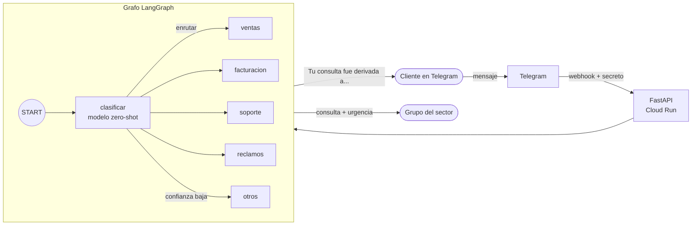

# 🤖 Clasificador de consultas para Telegram

Bot de Telegram que **lee el mensaje de un cliente, detecta a qué área corresponde** (ventas,
facturación, soporte técnico, reclamos u otros) y **lo deriva al grupo del equipo indicado**,
marcando las consultas urgentes.

Está construido con **LangGraph** y un **modelo de IA de código abierto que corre dentro del
propio servidor**: no usa APIs de IA externas, no necesita API keys y los mensajes de los clientes
no salen de tu infraestructura. Se despliega en **Google Cloud Run** con un solo comando y, con
tráfico bajo, entra en la capa gratuita.


---

## Contenido

- [Cómo funciona](#cómo-funciona)
- [Características](#características)
- [Estructura del proyecto](#estructura-del-proyecto)
- [Despliegue en Google Cloud (un solo bloque)](#despliegue-en-google-cloud-un-solo-bloque)
- [Desarrollo local](#desarrollo-local)
- [Docker](#docker)
- [Configuración](#configuración)
- [Personalizar los sectores](#personalizar-los-sectores)
- [Derivar a grupos de Telegram por sector](#derivar-a-grupos-de-telegram-por-sector)
- [El modelo de IA](#el-modelo-de-ia)
- [Seguridad](#seguridad)
- [Costos](#costos)
- [Solución de problemas](#solución-de-problemas)

---

## Cómo funciona



1. El cliente le escribe al bot por privado.
2. Telegram envía el mensaje al servidor (webhook protegido con un secreto).
3. El nodo **clasificar** evalúa el mensaje contra frases que describen cada sector y mide su
   urgencia, todo en una sola pasada del modelo.
4. El grafo **enruta** al sector con mayor puntaje. Si ninguno supera el umbral de confianza, el
   mensaje va a **otros** (atención humana general).
5. El bot le responde al cliente y, si está configurado, reenvía la consulta al grupo de Telegram
   del sector, con la marca 🔴 **URGENTE** cuando corresponde.

## Características

- 🧠 **Clasificación con IA sin entrenamiento**: los sectores se definen con frases en español.
- 🔒 **Privado y sin costo por mensaje**: el modelo corre en tu servidor, sin APIs externas.
- 🚨 **Detección de urgencia** en la misma pasada.
- 🛟 **Falla de forma segura**: ante baja confianza o error, deriva a atención humana.
- 📣 **Derivación a grupos** de Telegram por sector (opcional).
- 🐳 **Dockerizado**, con el modelo incluido en la imagen.
- 🚀 **Despliegue en un comando** con verificaciones previas y mensajes de error claros.
- 🛡️ **Seguro por defecto**: webhook autenticado, límite de mensajes, sin secretos en los logs.

## Estructura del proyecto

```
.
├── app/
│   ├── graph.py          # Grafo LangGraph: sectores, modelo, clasificación y enrutamiento
│   └── main.py           # Servidor FastAPI: webhook de Telegram y envío de respuestas
├── desplegar.ps1         # Crea el proyecto en GCP, despliega y conecta Telegram (Windows)
├── probar_local.py       # Pruebas locales: clasificar ejemplos o correr el bot sin webhook
├── Dockerfile            # Imagen para Cloud Run (incluye el modelo)
├── requirements.txt      # Dependencias con versión fija
├── env.example.yaml      # Plantilla de variables para el despliegue
└── .env.example          # Plantilla de variables para pruebas locales
```

---

## Despliegue en Google Cloud (un solo bloque)

### Requisitos previos

| Qué | Dónde |
|---|---|
| Un bot de Telegram y su **token** | Hablale a [@BotFather](https://t.me/BotFather) → `/newbot` |
| Cuenta de Google con **facturación activa** | [console.cloud.google.com/billing](https://console.cloud.google.com/billing) (Cloud Run la exige aunque uses la capa gratuita) |
| **Google Cloud CLI** | Windows: `winget install Google.CloudSDK` · Otros: [instrucciones](https://cloud.google.com/sdk/docs/install) |
| **Git** | [git-scm.com](https://git-scm.com/) |

> Después de instalar Google Cloud CLI, **abrí una terminal nueva** para que reconozca `gcloud`.

Elegí un **ID de proyecto** único en todo Google Cloud (6 a 30 caracteres: minúsculas, números y
guiones, empezando con una letra), por ejemplo `clasificador-bot-4821`, y reemplazalo en la
primera línea del bloque.

### Windows (PowerShell)

```powershell
$PROYECTO = "clasificador-bot-4821"
git clone https://github.com/juanm4ram/clasificador-bot.git; cd clasificador-bot
$t = (Read-Host "Pegá el token de @BotFather").Trim().Trim('"'); $s = -join ((48..57) + (65..90) + (97..122) | Get-Random -Count 32 | ForEach-Object { [char]$_ }); $c = (Get-Content env.example.yaml) -replace '^TELEGRAM_TOKEN:.*$', "TELEGRAM_TOKEN: `"$t`"" -replace '^WEBHOOK_SECRET:.*$', "WEBHOOK_SECRET: `"$s`""; [IO.File]::WriteAllLines("$PWD\env.yaml", $c)
powershell -ExecutionPolicy Bypass -File .\desplegar.ps1 -Proyecto $PROYECTO
```

El script [`desplegar.ps1`](desplegar.ps1) hace todo en orden y se detiene en el primer error con
un mensaje claro:

1. Verifica `env.yaml` y que Telegram acepte el token.
2. Inicia sesión en Google (abre el navegador) si hace falta.
3. Crea el proyecto si no existe y le vincula tu cuenta de facturación.
4. Habilita Cloud Run, Cloud Build y Artifact Registry.
5. Le da a la cuenta de servicio del proyecto el rol `roles/run.builder` (necesario en proyectos nuevos).
6. Construye la imagen Docker en Cloud Build y la despliega en Cloud Run (5 a 10 minutos).
7. Conecta el webhook de Telegram con el secreto.

Para volver a desplegar después de un cambio, ejecutá solo la última línea.

### Linux, macOS o Cloud Shell (Bash)

```bash
PROYECTO="clasificador-bot-4821"; REGION="us-central1"
git clone https://github.com/juanm4ram/clasificador-bot.git && cd clasificador-bot
read -rp "Pegá el token de @BotFather: " TOKEN; SECRET=$(LC_ALL=C tr -dc 'A-Za-z0-9' </dev/urandom | head -c 32)
sed -e "s|^TELEGRAM_TOKEN:.*|TELEGRAM_TOKEN: \"$TOKEN\"|" -e "s|^WEBHOOK_SECRET:.*|WEBHOOK_SECRET: \"$SECRET\"|" env.example.yaml > env.yaml
gcloud auth login
gcloud projects create "$PROYECTO" --name="$PROYECTO"
gcloud billing projects link "$PROYECTO" --billing-account="$(gcloud billing accounts list --filter=open=true --format='value(name)' --limit=1)"
gcloud config set project "$PROYECTO"
gcloud services enable run.googleapis.com cloudbuild.googleapis.com artifactregistry.googleapis.com
NUMERO=$(gcloud projects describe "$PROYECTO" --format='value(projectNumber)')
gcloud projects add-iam-policy-binding "$PROYECTO" --member="serviceAccount:${NUMERO}-compute@developer.gserviceaccount.com" --role=roles/run.builder --condition=None --quiet --format=none
gcloud run deploy clasificador-bot --source . --region "$REGION" --allow-unauthenticated --env-vars-file env.yaml --memory 4Gi --cpu 2 --cpu-boost --concurrency 1 --max-instances 2 --timeout 60 --quiet
URL=$(gcloud run services describe clasificador-bot --region "$REGION" --format='value(status.url)')
curl -s "https://api.telegram.org/bot${TOKEN}/setWebhook" -d "url=${URL}/webhook" -d "secret_token=${SECRET}" --data-urlencode 'allowed_updates=["message"]'
```

En [Cloud Shell](https://shell.cloud.google.com) no hace falta `gcloud auth login`.

### Verificar

Escribile a tu bot, por ejemplo: *"me cobraron dos veces la factura"*. Para ver cómo clasificó:

```bash
gcloud run services logs read clasificador-bot --region us-central1
```

> El primer mensaje después de un rato sin uso tarda ~20-30 s (Cloud Run arranca el servidor y
> carga el modelo). Los siguientes, 1-3 s. Para evitar la espera, agregá `--min-instances 1` al
> deploy (el servidor queda siempre encendido y deja de ser gratuito).

---

## Desarrollo local

Requiere Python 3.10 o superior.

```bash
python -m venv .venv
source .venv/bin/activate       # Windows (PowerShell): .venv\Scripts\Activate.ps1
pip install -r requirements.txt
cp .env.example .env            # Windows: copy .env.example .env
```

Completá `TELEGRAM_TOKEN` en `.env` y luego:

```bash
python probar_local.py          # clasifica mensajes de ejemplo (la 1ª vez descarga el modelo, ~1 GB)
python probar_local.py --bot    # corre el bot en tu PC con polling, sin webhook ni servidor público
```

> El modo `--bot` borra el webhook del bot. Cuando vuelvas a usar Cloud Run, ejecutá de nuevo el
> despliegue (o solo el paso de `setWebhook`).

## Docker

La imagen incluye el modelo, corre sin root y en producción no descarga nada de internet.

```bash
docker build -t clasificador-bot .
docker run --rm -p 8080:8080 --env-file .env clasificador-bot
curl http://localhost:8080/     # {"ok":true}
```

Para recibir mensajes reales, Telegram necesita una URL pública con HTTPS (como la de Cloud Run).
Para chatear con el bot en tu PC, usá `python probar_local.py --bot`.

---

## Configuración

| Variable | Obligatoria | Descripción |
|---|---|---|
| `TELEGRAM_TOKEN` | ✅ | Token del bot, de @BotFather |
| `WEBHOOK_SECRET` | ✅ | Secreto que Telegram envía en cada pedido. 16-256 caracteres: letras, números, `_` o `-`. Sin él, el bot rechaza todo |
| `UMBRAL_CONFIANZA` | | Puntaje mínimo (0 a 1) para derivar a un sector; si no se alcanza, va a "otros". Por defecto `0.4` |
| `SECTOR_CHAT_IDS` | | JSON con el `chat_id` del grupo de cada sector. Ej: `{"ventas": -100123, "soporte": -100456}` |

Para el despliegue van en `env.yaml` y para pruebas locales en `.env`. **Ninguno de los dos se
sube a Git** (están en `.gitignore`).

## Personalizar los sectores

Los sectores están en el diccionario `SECTORES` de [`app/graph.py`](app/graph.py). Cada uno tiene
frases que completan *"El cliente …"*. El modelo mide de 0 a 1 cuánto se cumple cada frase y el
sector toma el puntaje de su mejor frase.

```python
"soporte": {
    "nombre": "Soporte técnico",
    "emoji": "🛠️",
    "hipotesis": [
        "tiene un problema técnico",
        "dice que algo no funciona, no carga o da error",
        "no puede ingresar a su cuenta",
    ],
},
```

- **Para mejorar la precisión**, agregá frases con el vocabulario real de tus clientes.
- **Para agregar un sector**, sumá una entrada nueva con su nombre, emoji y frases.
- Probá los cambios con `python probar_local.py` antes de desplegar.

## Derivar a grupos de Telegram por sector

1. Creá un grupo por sector y agregá el bot a cada uno. El bot solo clasifica mensajes privados,
   así que no responde lo que se hable en los grupos.
2. Obtené el `chat_id` de cada grupo (número negativo): quitá el webhook, enviá
   `/start@TuBot` en cada grupo y consultá `getUpdates`:

   ```bash
   curl "https://api.telegram.org/bot<TOKEN>/deleteWebhook"
   curl "https://api.telegram.org/bot<TOKEN>/getUpdates"
   ```

3. Agregalos en `env.yaml` y volvé a desplegar (esto también reconecta el webhook):

   ```yaml
   SECTOR_CHAT_IDS: '{"ventas": -1001111111111, "facturacion": -1002222222222, "soporte": -1003333333333}'
   ```

Cada consulta llega al grupo con el nombre del cliente, el mensaje, la confianza, los puntajes y
la marca 🔴 URGENTE cuando corresponde.

---

## El modelo de IA

Se usa [`MoritzLaurer/bge-m3-zeroshot-v2.0`](https://huggingface.co/MoritzLaurer/bge-m3-zeroshot-v2.0),
un modelo de **clasificación zero-shot** (clasifica sin entrenarlo, a partir de descripciones)
basado en `BAAI/bge-m3`, multilingüe y con licencia **MIT**.

- **Precisión medida** con 28 mensajes de clientes en español: **25/28 (~89%)** en sector y
  **6/6** en urgencia. Casi todos los errores terminan en "otros", es decir, los atiende una
  persona. Las frases se ajustaron con esos mismos mensajes, así que con clientes reales conviene
  revisar los logs y sumar frases.
- **Rendimiento**: ~1-3 s por mensaje en CPU, ~2 GB de RAM.
- **Por qué este modelo**: frente a `mDeBERTa-v3-base-mnli-xnli` y a variantes con hipótesis en
  inglés, fue el que mejor separó los sectores y el único que reconoció bien saludos y consultas
  generales.

## Seguridad

| Riesgo | Mitigación |
|---|---|
| Pedidos falsos al webhook | Telegram envía un `secret_token` en cada pedido; se valida con comparación en tiempo constante. Sin secreto configurado se rechaza todo (403) |
| Token del bot en los logs | Los logs de `httpx` (que incluyen la URL con el token) están silenciados |
| Datos personales en los logs | Solo se registra el sector y los puntajes, nunca el texto del cliente |
| Abuso y costos | Máximo 5 mensajes por minuto por usuario, mensajes recortados a 300 caracteres, `--concurrency 1` y `--max-instances 2` en Cloud Run |
| Modelo alterado o malicioso | Versión fija (commit), solo pesos `safetensors` (no ejecutan código al cargarse); el archivo *pickle* del repositorio no se descarga; sin descargas en producción |
| Dependencias vulnerables | Versiones fijas en `requirements.txt`, revisadas con `pip-audit` |
| Contenedor | Corre sin root; la documentación automática de FastAPI (`/docs`) está deshabilitada |
| Secretos en el repositorio | `env.yaml` y `.env` están en `.gitignore`, `.gcloudignore` y `.dockerignore` |

Para revisar las dependencias:

```bash
pip install pip-audit && pip-audit --no-deps -r requirements.txt
```

**Recomendado para producción:** guardar `TELEGRAM_TOKEN` y `WEBHOOK_SECRET` en
[Secret Manager](https://cloud.google.com/run/docs/configuring/services/secrets) en lugar de
variables de entorno.

## Costos

| Servicio | Costo |
|---|---|
| Modelo de IA | Gratis (código abierto, corre en tu servidor) |
| Cloud Run | La capa gratuita mensual alcanza para varios miles de mensajes. Con 0 instancias mínimas no cobra mientras nadie escribe |
| Artifact Registry | La imagen ocupa ~3 GB (0,5 GB gratis): unos centavos de dólar por mes. Borrá las imágenes viejas |
| Cloud Build | Cada despliegue usa unos minutos de build, dentro de la cuota gratuita |

Se recomienda crear una [alerta de presupuesto](https://console.cloud.google.com/billing/budgets).

## Solución de problemas

| Síntoma | Causa y solución |
|---|---|
| `gcloud : El término 'gcloud' no se reconoce...` | Google Cloud CLI no está instalado, o se instaló en esa misma terminal. Abrí una terminal **nueva** |
| `TELEGRAM_TOKEN ... todavía es el de ejemplo` | `env.yaml` no se guardó. El Bloc de notas de Windows 11 recuerda el texto sin guardarlo en el archivo: usá **Ctrl+S** o el comando del bloque de despliegue |
| `Unauthorized` (401) de Telegram | El token es incorrecto o está incompleto. Pedí uno nuevo con `/token` a @BotFather |
| `PERMISSION_DENIED: Build failed because the default service account is missing required IAM permissions` | Falta el rol `roles/run.builder` en la cuenta de servicio. El script lo asigna; si persiste, esperá 1-2 minutos y reintentá |
| No se pudo crear el proyecto | El ID ya existe en Google Cloud. Elegí otro |
| El bot no responde | Revisá `getWebhookInfo` (`https://api.telegram.org/bot<TOKEN>/getWebhookInfo`) y los logs de Cloud Run |
| El primer mensaje tarda mucho | Arranque en frío: es normal. Usá `--min-instances 1` si necesitás respuesta inmediata |
